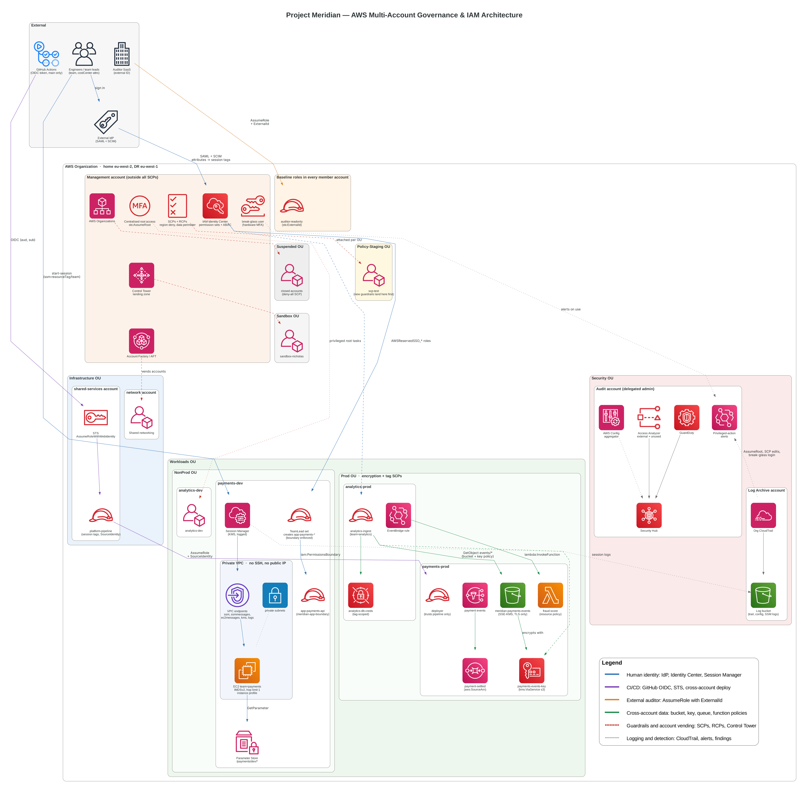

# aws-control

Codifies the AWS Control Tower landing zone for Meridian Payments Ltd with Terraform: organizational units, Control Tower registration, and account vending with Account Factory for Terraform (AFT).



## Repository layout

```
aws-control/
├── bootstrap/           # one-off: creates the S3 state bucket (local state)
├── live/
│   ├── management/      # root module: OUs + Control Tower registration
│   └── aft/             # root module: deploys AFT (aws-ia/control_tower_account_factory/aws)
└── modules/
    └── ous/             # one OU + its Control Tower baseline
```

Each folder under `live/` is a root module: run `terraform` from inside it. `modules/` are only ever called from a root module.

AFT reads four more repos in the `Infra-bubble` GitHub org. You push to them, and AFT applies them:

| Repo | Purpose |
|---|---|
| `aft-account-request` | Accounts to vend, and their tags |
| `aft-global-customizations` | Terraform applied in every vended account (`platform-baseline` role) |
| `aft-account-customizations` | Per-account Terraform, selected by `account_customizations_name` |
| `aft-account-provisioning-customizations` | Step Functions hooks during provisioning (template default) |

## Target organization

| OU | Parent | Accounts |
|---|---|---|
| Security | Root | Audit, Log Archive (created by Control Tower) |
| Infrastructure | Root | network, shared-service |
| Workloads | Root | — |
| Prod | Workloads | payment-prod, analytics-prod |
| NonProd | Workloads | payment-dev, analytics-dev |
| Sandbox | Root | sandbox-nick |
| Policy-Staging | Root | scp-test |
| Suspended | Root | — |
| AFT-Management | Root | aft-management |

| Account | ID | Role |
|---|---|---|
| Management | `790013274466` | Organizations, Control Tower, Terraform runs |
| Audit | `783495713938` | Created by Control Tower |
| Log Archive | `263953131739` | Created by Control Tower |
| aft-management | `255291985306` | Hosts the AFT pipelines |
| sandbox-nick | `810711873528` | First AFT-vended account (Sandbox OU) |

Home region: `eu-west-2`. Governed regions: `eu-west-2`, `eu-west-1`, `eu-north-1`.

## Prerequisites

- Terraform >= 1.10 (S3-native state locking)
- AWS CLI v2 with an IAM Identity Center profile for the management account
- Credentials exported in every terminal that runs Terraform. The S3 backend does not read the provider block, so the profile must come from the environment:

  ```bash
  export AWS_PROFILE=nick
  export AWS_REGION=eu-west-2
  aws sso login            # when the session expires
  ```

- No static keys for the same profile in `~/.aws/credentials`. The Terraform AWS provider prefers them over SSO and fails with `InvalidClientTokenId` if they are stale.

## Steps

### 1. Create the organization and landing zone (console)

1. Created AWS Organizations from the management account.
2. Enabled Control Tower (landing zone 4.0, home region `eu-west-2`). This created:
   - the **Security** OU
   - the **Audit** and **Log Archive** accounts
   - IAM Identity Center, managed by Control Tower

These are owned by Control Tower and are not managed in this repo.

### 2. Bootstrap the state bucket

```bash
cd bootstrap
terraform init
terraform apply
```

Creates `meridian-payments-ltd-management-tfstate-bucket` (versioned, public access blocked). This root module uses local state, since the bucket can't hold its own state before it exists. `terraform.tfstate` here is gitignored; keep it safe.

### 3. Create and register the OUs

```bash
cd live/management
terraform init
terraform plan
terraform apply -parallelism=3
```

State: `s3://meridian-payments-ltd-management-tfstate-bucket/management/terraform.tfstate`.

For every OU, `modules/ous` creates:
- `aws_organizations_organizational_unit`
- `aws_controltower_baseline`, which registers the OU with Control Tower (`AWSControlTowerBaseline` v5.0, with the `IdentityCenterEnabledBaselineArn` parameter)

OU names live in `live/management/locals.tf`. Prod and NonProd `depends_on` the top-level OUs, because Control Tower only registers a child once its parent is registered.

`-parallelism=3` is required. Control Tower runs about three baseline operations at once and rejects the rest with `409 ConflictException`. If that happens, check that nothing is still in progress before re-applying:

```bash
aws controltower list-enabled-baselines \
  --query 'enabledBaselines[?contains(baselineIdentifier,`17BSJV3IGJ2QSGA2`)].[targetIdentifier,statusSummary.status]' \
  --output table
```

`SUCCEEDED` means registered, `UNDER_CHANGE` means wait, and `FAILED` means check the Control Tower console.

> OUs originally created in the console were deregistered in Control Tower and deleted in Organizations (children first) before the first apply, so Terraform owns all of them.

### 4. Grant the SSO role access to Account Factory

Control Tower only grants its own `AWSAdministratorAccess` permission set access to the Account Factory portfolio. To create accounts with the `AdministratorAccess` permission set, add it once:

Service Catalog → Portfolios → **AWS Control Tower Account Factory Portfolio** → Access → Grant access → Roles → `AWSReservedSSO_AdministratorAccess_*`

Without this, Account Factory fails with *"Your AWS IAM identity does not have access to the AWS Control Tower Account Factory portfolio"*.

### 5. Create the AFT management account

AFT has to live in its own account, which must exist before AFT is deployed. `AFT-Management` was added to `top_level_ous` and applied, then the account was vended through Account Factory:

```bash
aws servicecatalog provision-product \
  --product-id prod-jc7yxw7eh77ke \
  --provisioning-artifact-id pa-hliachkkfvpuq \
  --provisioned-product-name aft-management \
  --provisioning-parameters \
    Key=AccountName,Value=aft-management \
    Key=AccountEmail,Value=<new-unique-root-email> \
    Key=ManagedOrganizationalUnit,Value=AFT-Management \
    Key=SSOUserEmail,Value=<existing-identity-center-user-email> \
    Key=SSOUserFirstName,Value=<first> \
    Key=SSOUserLastName,Value=<last>
```

- `AccountEmail` is the new account's root email. It must never have been used by another AWS account (plus-addressing such as `name+aft@gmail.com` works).
- `SSOUserEmail` is the Identity Center user who gets admin access. An existing user is reused; an unknown email creates a new user.

Track progress until `AVAILABLE` (about 20–30 minutes):

```bash
aws servicecatalog scan-provisioned-products \
  --query 'ProvisionedProducts[?Name==`aft-management`].[Status,StatusMessage]' --output text
```

The account is created at the org root and moved into its OU partway through. Don't deploy AFT until it is `AVAILABLE` and shows as **Enrolled** in Control Tower.

### 6. Create the AFT repos

Created the four AFT repos as private, empty repos in `Infra-bubble`, then copied in the AWS templates:

```bash
git clone --depth 1 https://github.com/aws-ia/terraform-aws-control_tower_account_factory.git aft-upstream
for r in aft-account-request aft-global-customizations aft-account-customizations aft-account-provisioning-customizations; do
  git clone https://github.com/Infra-bubble/$r.git
  cp -R aft-upstream/sources/aft-customizations-repos/$r/. $r/
  (cd $r && git add -A && git commit -m "AFT template" && git push -u origin main)
done
```

The AFT module itself is not cloned. `terraform init` downloads it from the Terraform Registry.

### 7. Deploy AFT

```bash
cd live/aft
terraform init
terraform plan        # ~340 resources
terraform apply
```

State: `s3://meridian-payments-ltd-management-tfstate-bucket/aft/terraform.tfstate`.

- Runs with **management account** credentials. `live/aft` has no provider block, because the AFT module configures its own providers and assumes `AWSControlTowerExecution` into the AFT, Audit and Log Archive accounts.
- Module pinned to `1.22.0`, `vcs_provider = "github"`, repos named `Infra-bubble/aft-*`.
- `aft_enable_vpc = false` and `aft_vpc_endpoints = false` stop AFT creating a VPC, NAT gateways and endpoints, which is the main running cost.
- What AFT creates: pipelines, CodeBuild, Lambdas, Step Functions, DynamoDB and SSM in the AFT account; `AWSAFTExecution` / `AWSAFTService` roles in the management, Audit and Log Archive accounts; an `aft-logging` bucket in Log Archive.

The first apply can fail with `AccessDeniedException ... codebuild:StartBuild` from `aft-lambda-layer-codebuild-trigger`. That's IAM eventual consistency, where the Lambda runs before its new role policy has propagated. Run `terraform apply` again.

### 8. Approve the GitHub connection

AFT creates `ct-aft-github-connection` in the AFT account in **Pending** state, and its two pipelines fail with *"Connection ct-aft-github-connection is not available"* until it's approved.

1. Sign in to the access portal (`https://d-9c67b48b57.awsapps.com/start`) → **aft-management** → **AWSAdministratorAccess**, region London.
2. Open `https://eu-west-2.console.aws.amazon.com/codesuite/settings/connections?region=eu-west-2` (CodePipeline → Settings → Connections).
3. Select `ct-aft-github-connection` → **Update pending connection** → authorise **AWS Connector for GitHub**, installed on the **Infra-bubble** org with access to the four `aft-*` repos.
4. Status becomes **Available**. Re-run `ct-aft-account-provisioning-customizations` with **Release change** to confirm the Source stage succeeds.

### 9. Vend an account

Accounts are defined in `aft-account-request/terraform/locals.tf`. Each entry in `local.accounts` is one account:

```hcl
accounts = {
  "sandbox-nick" = {
    email          = "<name>+sandbox-nick@gmail.com"   # unique root email, never reused
    ou             = "Sandbox"                         # nested OUs: "Prod (ou-xxxx-xxxxxxxx)"
    environment    = "sandbox"
    customizations = ""                                # folder in aft-account-customizations
    reason         = "First AFT-vended account to test the pipeline"
  }
}
```

The global customization in `aft-global-customizations/terraform/main.tf` creates `platform-baseline` in every vended account: an IAM role with `ReadOnlyAccess` that the management account can assume.

Push `aft-global-customizations` first, then `aft-account-request`. Every push to `aft-account-request` runs the request pipeline:

| Change to `local.accounts` | Result |
|---|---|
| Add an entry | New account vended and customized |
| Change tags / customizations | Existing account updated |
| Remove an entry | AFT stops managing it; the account is **not** closed |

What happens after a push (all in the AFT account), and how long `sandbox-nick` took:

| Step | Where | Time |
|---|---|---|
| Request written to DynamoDB `aft-request` (keyed by account email) | CodePipeline `ct-aft-account-request` | ~1 min |
| Stream → Lambda → SQS → processor (every 5 min) → Service Catalog | Lambda / SQS | ~1 min |
| Account created and enrolled | Service Catalog (management account) | ~11 min |
| Tags applied, metadata stored, customizations triggered | Step Functions `aft-account-provisioning-framework` | ~4 min |
| Global then account customizations applied | CodePipeline `<account-id>-customizations-pipeline` | ~2 min |

The Step Functions framework only starts after Control Tower reports the account as created, so it doesn't appear until Service Catalog finishes.

Per-account customization pipelines don't run on a push to the customization repos (`DetectChanges = false`). To re-apply a customization change to existing accounts, either **Release change** on `<account-id>-customizations-pipeline`, or start Step Functions `aft-invoke-customizations` with `{"include":[{"type":"all"}]}`.

### 10. Tagging convention

Every resource and account carries the same keys:

| Key | Value |
|---|---|
| `Project` | `meridian-payments-ltd` |
| `ManagedBy` | `Terraform` for `aws-control` (applied by hand); `AFT` for anything AFT applies |
| `Path` | The repo and folder that owns it, e.g. `aws-control/live/management`, `aft-global-customizations/terraform` |
| `Environment` | Per root module or per vended account (e.g. `management`, `aft`, `sandbox`) |

Tags are defined once in each root module's `locals.tf` as `local.tags`. In the AFT repos, `aft-providers.jinja` applies them to every resource through `default_tags { tags = local.tags }`, replacing AFT's default `managed_by = "AFT"` tag. Vended accounts get `local.tags` plus their `Environment` as Organizations tags.

Search by `Path` in **Resource Groups → Tag Editor** to find everything a given folder created.

### Next

- [ ] Account quota increase: the org is at 5 of 5 accounts (us-east-1 → Service Quotas → AWS Organizations → Maximum number of accounts)
- [ ] Vend the remaining accounts: network, shared-service, payment-prod, analytics-prod, payment-dev, analytics-dev, scp-test

## Teardown

Delete in this order:

1. Close vended accounts (Organizations). Removing them from `aft-account-request` does not close them.
2. `terraform destroy` in `live/aft`
3. Close the AFT management account
4. Decommission the Control Tower landing zone
5. Delete the organization
